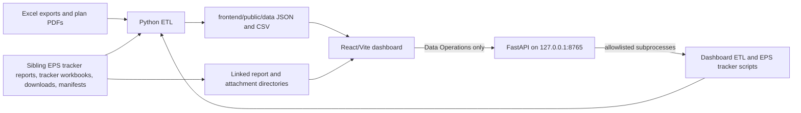

# Architecture

## Purpose

The IAD6 Infralink Dashboard combines engineering exports and locally managed
test/report artifacts into operational views centered on PDMs and equipment.
It covers readiness, issues, Infralink NETA evidence, third-party EPS execution,
monthly KPR metrics, data quality, floor/power-plan views, and MV equipment.

The repository contains two distinct runtime surfaces:

1. A React dashboard that primarily reads generated static JSON.
2. A local FastAPI control plane that runs a fixed set of Python automation
   jobs against this repository and a sibling EPS tracker repository.

## System Flow

The registered CxAlloy upload job invokes `scripts/automation/cxalloy_upload.py`
with the configured EPS Tracker root and the operator's auth state. This adapter
reuses the sibling uploader's browser and matrix helpers while guarding PDF
selection with shared `scripts/etl/cxalloy_upload_plan.py` evidence checks.
Historical package digests prove per-PDF contents and original site filenames;
new cable attachments do not cause old renamed PDFs to be uploaded again.
The status builder uses the same content coverage rules. Force is unsupported
for this job; uncertain history/site state fails closed. No live upload occurs
without the existing explicit confirmation.

## Frontend Architecture

### Entry and routing

- `frontend/src/main.tsx` mounts `App` inside `BrowserRouter`.
- `frontend/src/App.tsx` owns route composition, common layout, loading/error
  boundaries, and return-to-Overview/KPR navigation state.
- Current routes: `/overview`, `/kpr`, `/pdms`, `/equipment`, `/issues`,
  `/eps-test-execution`, `/power-plan`, `/layout`, `/mv-equipment`, `/data-quality`, and
  `/data-operations`.
- All route pages load their code on demand inside a shared Suspense boundary.

### Data loading

`InfralinkEquipmentLinksProvider` loads the optional generated device-ID
manifest independently, and reloads it when ETL metadata changes. The shared
detail-header link component builds JC2's main `DeviceFullPage;viewModelId=...`
route from a validated numeric ID. The main application handles sign-in and
hosts the embedded detail; linking directly to the embedded Angular application
can produce a blank Session-401 page in signed-out browsers. Automation storage
state is never transferred to browser links. Exact equipment references resolve links; missing and
ambiguous identities stay unavailable. This covers nested PDM details and
Layout cable inspectors as well as the equipment/map routes.

`frontend/src/hooks/useDashboardData.ts` loads data in two tiers:

- Initial operational data: PDMs, summary/metadata, EPS datasets, manifests,
  power-plan data, CxAlloy status, history, and KPR summary.
- Deferred detail data: equipment, cases, module links, and data-quality report,
  loaded only for routes that need them.
- Concurrent requests for the same JSON URL share one pending request, avoiding
  duplicate fetch/parse work under development StrictMode. Settled results are
  not cached, preserving later reloads of updated files.
- Dev and compiled preview intercept `/data/` JSON/CSV requests and stream live
  files from `frontend/public/data/` with `no-store`. Preview retains built JS/CSS
  but reflects successful ETL outputs without a frontend rebuild. Missing live
  files return 404; path containment, real paths and extensions restrict serving.
- NETA PDF requests under `/neta-reports/` and `/neta-reports-gc/` also use live
  public directories/junctions in dev and preview. Missing reports return 404
  rather than SPA HTML; byte ranges support browser PDF viewers. Files remain
  constrained to each configured report root after realpath resolution.
  Issue attachments and reference drawings also use their live public roots.
  Compiled-preview startup omits public-file copying; ordinary static builds
  retain it.

The loader distinguishes initial and detail error states, but `fetchJson`
currently converts HTTP/network/parse failures to `null` plus a console warning;
missing files can therefore yield empty/null data rather than throwing. Several
specialist datasets are explicitly optional. `unwrapRecords` accepts both plain
arrays and record envelopes.

### UI organization

- `pages/` contains route-level screens.
- Domain components live under `components/{pdms,equipment,issues,overview}`.
- Shared visual primitives are under `components/common` and `components/ui`.
- Domain calculations, matching helpers, search, report linking, and Excel
  exports are under `utils/`.
- `types/data.ts` and `types/automation.ts` are the frontend contracts.
- Tests are colocated as `*.test.ts` and `*.test.tsx`, using Vitest, jsdom, and
  Testing Library.

The Equipment page flattens PDM equipment plus standalone equipment records so
that equipment missing from module links can still appear in global metrics and
lookup. URL query parameters carry drill-down filters from Overview and KPR.

## ETL Architecture

### Inputs and discovery

`scripts/etl/file_discovery.py` selects the newest non-temporary workbook from:

- `raw_data/module/*.xlsx`
- `raw_data/system_elements/SystemElements_*.xlsx`
- `raw_data/cases/Cases_*.xlsx`

Power-plan builders also read PDFs from `raw_data/power_plan/`. Several EPS,
NETA, attachment, CxAlloy, and MV inputs are read from a sibling
`IAD6_EPS_Testing_Tracker` repository.

`build_layout_plan.py` separately reads the PDF/page/floor mappings in
`config/layout_plans.json`. Rectangle comments identify equipment; one boundary
rectangle clips each floor, and fix rectangles place contained devices in a
shared layer. Both controls are omitted from the SVG. Rotated PDF coordinates
are transformed and made relative to the boundary origin. Normalized equipment
IDs match only when unique; uncertain records remain visible with diagnostics.
`layout_plan.json` carries the floor geometry and SystemElements energized dates.
The `/layout` page loads this file on demand, keeps a common coordinate frame
across floors, and stores manual electrical-status overrides in browser storage.
Overrides are keyed by equipment ID and never modify workbook or server data.
POD and E-number room annotations are separate noninteractive regions, with
optional shared fixed regions. Equipment gets a bounded visual inset; source
geometry remains intact. Room labels have fixed positions in the background;
2.5D uses larger external callouts beyond the room back edges with leader lines,
included in the shared fit bounds. The 2D labels keep their inside positions.
Equipment is drawn above them, and all lightning markers are drawn together in
the final SVG layer. Energized has a stronger red fill/border. The SVG uses
a fixed-size canvas and a movable viewBox, pointer capture for panning, and a
non-passive wheel handler with cursor-anchored zoom. Global search suggestions
select the appropriate floor and focus the device. A single Energize today
toggle and reset controls replace the equipment-status selector.
Confirmed Excel energisation takes priority over stored planning overrides;
effective Energized status locks the planning button. A bounded HTML inspection
card shows the full ID/status on hover or keyboard focus at a fixed font size,
independent of SVG scale, without intercepting map pointer events.
Box select changes the pointer gesture from panning to a marquee in drawing
coordinates. It selects fully enclosed equipment IDs; Shift adds another group.
Bulk planning is idempotent and skips Energized IDs using the shared status rule.
Selection is cleared on floor changes/search confirmation/exit; overrides remain
in the existing browser-local storage, with existing global reset behavior.

Layout also offers a default 2.5D orthographic 2:1 SVG projection with illustrative device
heights and overhead cable routing, while keeping source footprints unchanged.
`layout_connections.py` adds optional `cables`, `cable_diagnostics`, and EPS/MV
daily report source metadata to the Layout manifest. Classification uses normalized equipment
Type; termination records are excluded. Complete FDR endpoint IDs are matched
against unique equipment IDs; unresolved/single-ended FD records remain in the
dataset. The frontend draws only unique endpoint placements visible on the chosen
floor, avoiding invented cross-floor or duplicate-placement associations.
`layoutIsometricUtils.ts` owns projection, device kinds, connection placement, and
overhead paths. Both views share the existing camera and planning state; switching
views resets the camera/selection geometry. Layout indexes exact FDR IDs from raw
EPS `Daily_test_report` files as well as MV daily results. `cableTestUtils.ts`
first treats a Feeder Cable ATP filename in System Elements as an attached
Infralink test report, then classifies the latest dated daily outcome when no
report is attached, using failure first on a same-day tie.
Cable test evidence and equipment
energisation remain independent; equipment tracking exclusions do not remove
physical cable connections. Global dashboard initial loading is unchanged.
Layout carries equipment NETA report names and cable `Feeder Cable ATP` names
from normalized System Elements. Its cable builder reuses Power Plan's ATP file
index, matching each listed filename within the exact cable ID folder. The
frontend previews those local PDFs; cable NETA PDFs are additionally resolved
by exact full FDR filename in the shared report manifest. A missing local PDF
remains an unclickable report reference, while its Infralink attachment field
still confirms that the report was entered there.
Linked ATP/NETA names are shown once; equipment PDF previews prefer GC-renamed
links. In 2.5D, selection only changes emphasis and detail state; explicit
Zoom actions own camera changes.
Equipment illustrations use closed, independently shaded top/left/right faces
and separate structures for the five device types. Nearby connections use low
cubic arcs; longer paths have rounded bends. Cable path bounds are included in
the shared fit frame and connection zoom. Global view/Escape clear focus and
search and restore the full camera without changing energisation overrides;
blank map clicks clear focus while retaining the current camera.
Layout performance separates static model geometry from selection overlays and
uses memoized equipment/cable/background components with stable event callbacks.
Current-floor 2.5D SVG models remain mounted, hidden, after switching to 2D;
floor changes still replace floor-local geometry. Cable paths, lookup indexes,
diagnostic counts and both view fit frames are memoized. `useFrameState.ts`
coalesces wheel/pan updates using requestAnimationFrame, flushes final drag
positions and cancels queued camera movement on explicit commands or unmount.
Hide all cables removes cable marks/hit targets without changing connection data;
Global view, search and floor/view changes preserve the user's visibility choice.

### Pipeline

`build_infralink_equipment_links.py` joins normalized equipment names to a local
project-scoped JC2 identity snapshot. Its optional CLI `--refresh --auth-state`
reads the same project contract scope used by the sibling NETA downloader and
queries JC2's paginated device grid using the saved session. Only names and
numeric IDs are retained. Complete snapshots replace the local cache atomically;
authentication errors, pagination inconsistencies and invalid identities fail
before replacement. Normal ETL stays offline and reports missing/ambiguous
links in the generated manifest. Existing published identities can be reused
when a deployment does not have the local cache.

`scripts/etl/run_etl.py` is the orchestrator. It runs, in order:

1. Workbook inspection and normalization of equipment, modules, and cases.
2. Equipment matching for module links and cases.
3. PDM dataset, summary, and data-quality report construction.
4. Seven-day/history, EPS execution, and monthly KPR datasets.
5. NETA, CxAlloy, issue-attachment, and power-plan/MV manifests.
6. ETL metadata and record-count reporting.

Each step writes under `frontend/public/data/`. The directory is generated and
gitignored. JSON outputs commonly include selected-input metadata and a
`records` array. The ETL stops on the first failed step; quality findings are
reported as data and do not stop the pipeline.

### Matching and assignment

- Equipment matching proceeds through exact, project-prefixed/normalized,
  whitespace/case-normalized, and terminal-suffix matching.
- A trailing `0x-R` and `0xR` suffix are treated as equivalent.
- Unique matches are `matched`; multiple matches are `ambiguous`; unmatched
  records are retained.
- PDM assignment may use a SystemElements parent only when it is a PDM and does
  not conflict with the module-list area scope.

### Main data models

There is no database. `scripts/etl/schemas.py` defines the normalized dataclass
contracts:

- `Equipment`
- `ModuleEquipmentLink`
- `CaseIssue`
- `PdmRecord`
- `PdmEquipmentRecord`
- `NetaValidationRecord`
- `DataQualityReport`

The primary hierarchy is PDM -> equipment -> cases. Additional generated models
cover EPS test items and module/PDM execution, KPR lifecycle/trends, report and
attachment manifests, power-plan annotations, MV daily test status, and
CxAlloy upload status.

## Automation Backend

`scripts/automation/api.py` exposes a FastAPI API. `scripts/automation/runner.py`
implements an allowlisted, single-active-run task manager with persisted run
records/logs under `runtime/automation/` (latest 50 exposed by the API).

API groups:

- Health, job definitions, runs, incremental logs, cancellation, and resume.
- Daily pipeline execution.
- JC2 and CxAlloy interactive login continuation.
- EPS and MV daily-report list/read/validate/save operations.

The daily pipeline runs preflight, JC2 workbook refresh, daily report wash,
NETA/Feeder ATP/issue downloads, GC organization, and dashboard ETL. It stops at
the first failure and can resume from a failed/auth-required/interrupted step.
Saving an EPS daily report atomically writes the Markdown file and starts the
wash job; saving an MV report does not run the EPS wash.

Commands are assembled from `JOB_DEFINITIONS`; clients cannot submit script
paths or arbitrary commands. Options are validated per job. Live CxAlloy upload
is marked dangerous and requires confirmation.

## Authentication and Authorization

- Dashboard viewing is public. Data Operations is gated by Clerk sign-in and
  server-side operator authorization. The free-plan setup uses Restricted access
  and invitations; `CLERK_ALLOWED_USER_IDS` independently controls API access.
- The backend validates Clerk RS256 session signatures using the configured
  issuer's JWKS, time claims, session status, and exact authorized frontend
  origins. Missing Clerk configuration denies remote operations. An opt-in local
  bypass permits only direct loopback requests with local host/origin and no
  proxy/forwarding headers; Vite marks every proxy request to prevent bypass.
  MV comment and NETA review GET endpoints remain public for viewing; their
  writes and all other automation endpoints require an authorized operator.
- Personal provider logins use owner-bound remote browser windows rendered as
  transient screenshots with restricted click/text/key/scroll actions. An
  isolated Playwright context supports Microsoft phone MFA and CxAlloy login.
  Save is allowed only back on the provider origin after login fields disappear
  and browser state exists. Screenshots/input are not persisted; sensitive
  storage state lives outside the repo under a hash of the verified Clerk ID.
- Provider jobs receive explicit personal `--auth-state` paths and never fall
  back to the shared VM state. Run records carry owner IDs; API history, logs,
  resume and cancellation are owner-scoped. The host retains a single job lock
  because project outputs remain shared. Legacy desktop-login HTTP endpoints
  return 410; direct local CLI behavior remains available for maintenance.
- The automation service is started on `127.0.0.1:8765`; CORS permits only
  localhost/loopback origins.
- JC2 and CxAlloy authentication is delegated to Playwright-driven sibling
  scripts. Browser state is stored outside the repository under local app data.
- Vite proxies `/api/automation` to the loopback backend, allowing an HTTPS ngrok
  tunnel to frontend port 5173 to serve authenticated operations. Clerk login
  does not replace the host's JC2/CxAlloy browser sessions.
- Vite's Feeder Cable ATP middleware only serves `.pdf` files resolved inside
  the configured ATP directory.

## External Integrations

- JC2: SystemElements/Cases exports, NETA reports, Feeder Cable ATP PDFs, issue
  and corrective attachments.
- Sibling EPS tracker: tracker Excel data, EPS and MV daily Markdown reports,
  report downloads, GC rename/upload manifests, and automation scripts.
- CxAlloy: optional confirmed report upload and upload-status reconciliation.
- Local filesystem links/junctions expose downloaded NETA and issue files under
  `frontend/public/` for browser viewing.

No integration credentials or endpoints belong in this repository.

## Configuration and Environment

- `IAD6_EPS_TRACKER_ROOT`: overrides the sibling tracker root for automation,
  CxAlloy status, power-plan/MV processing, and Vite ATP serving where supported.
- `VITE_AUTOMATION_API_URL`: overrides the frontend automation API base URL.
- `VITE_CLERK_PUBLISHABLE_KEY`: frontend Clerk instance key.
- `VITE_LOCAL_OPERATIONS_BYPASS`, `AUTOMATION_LOCAL_AUTH_BYPASS`: opt-in frontend
  and backend localhost access without Clerk. Local mode calls the loopback API
  directly; remote clients always use the marked Vite proxy and require auth.
- `CLERK_ISSUER`, `CLERK_AUTHORIZED_PARTIES`, `CLERK_ALLOWED_USER_IDS`: backend
  session validation and operator authorization. The local launcher loads these
  from root `.env.local`; Vite loads its own `frontend/.env.local`.
- `AUTOMATION_LOGIN_ALLOWED_HOSTS`: optional exact additional SSO/CDN hostnames.
- `AUTOMATION_LOGIN_HEADLESS`: defaults to true; false uses an interactive host
  browser while retaining owner-bound remote control.
- `CXALLOY_PROJECT_URL`: optional personal-login entry URL; default is read from
  the existing tracker upload script.
- `LOCALAPPDATA`: used indirectly to locate local browser auth-state files.
- `config/equipment_lifecycle.json`: lifecycle order, labels, status aliases,
  and colors used by KPR.
- The sibling tracker owns the configurable JC2 SystemElements view URL.

Secret values, browser state, raw exports, generated data, downloads, and
runtime logs are excluded from version control.

## Local Development and Deployment

`python scripts/start_dashboard.py` starts Uvicorn with reload on loopback port
8765 and Vite on loopback port 5173, and terminates both on Ctrl+C. The frontend
can also run independently with `npm run dev` after ETL data exists.

`npm run build` produces static assets in `frontend/dist/`. A static deployment
can serve dashboard pages and generated public data, but Data Operations and
local file integrations require the Python service, tracker repository, and
filesystem access. No database service is required.

## Important Decisions and Constraints

- PDM data is the principal grouping, while global Equipment also includes
  unlinked SystemElements records.
- NETA completion/report evidence and lifecycle inventory are separate metrics.
  Lifecycle stages are mutually exclusive and ordered by configuration.
- EPS is tracked at test-item/component level and must not be compared directly
  to equipment-level NETA totals without an explicit unit label.
- Issue and corrective evidence is preserved even when missing; missing values
  drive quality findings.
- Equipment containing `BATTERY`, `UPS6`, or `MBC`, plus direct `INV6`, is
  excluded from EPS/NETA tracking. Transformer IDs such as `TX-INV6` remain in
  scope.
- Report and attachment binaries remain outside generated JSON; manifests store
  metadata and browser paths.
- Data Operations intentionally remains a local control plane rather than a
  general remote execution API.

## Directory Map

| Path | Responsibility |
| --- | --- |
| `frontend/src/App.tsx` | Routes, loading boundaries, return navigation |
| `frontend/src/hooks/useDashboardData.ts` | Initial and deferred JSON loading |
| `frontend/src/pages/` | Dashboard route implementations |
| `frontend/src/types/` | Frontend data and automation contracts |
| `frontend/src/utils/` | Domain logic, search, links, and exports |
| `scripts/etl/run_etl.py` | Full ETL orchestration and metadata |
| `scripts/etl/schemas.py` | Normalized Python data contracts |
| `scripts/etl/tracking_rules.py` | Shared EPS/NETA inclusion rules |
| `scripts/etl/build_eps_test_execution.py` | Third-party test execution datasets |
| `scripts/etl/build_kpr_summary.py` | Monthly KPR and lifecycle movement |
| `scripts/etl/build_power_plan.py` | PDF annotations, MV tests, ATP evidence |
| `scripts/automation/api.py` | Local HTTP API |
| `scripts/automation/runner.py` | Allowlisted task and pipeline execution |
| `scripts/automation/daily_reports.py` | Safe EPS/MV Markdown handling |
| `config/equipment_lifecycle.json` | Ordered lifecycle definition |

## Known Gaps

- **Unknown:** The production hosting, reverse proxy, TLS, and CI/CD design is
  not present in this repository.
- **Unknown:** Canonical Python and Node.js versions are not pinned by project
  metadata.
- **Needs verification:** `vite.config.js`/`vite.config.ts` and
  `tailwind.config.js`/`tailwind.config.ts` coexist and are not equivalent; the
  intended source-of-truth configuration should be confirmed before cleanup.
- **Needs verification:** Some ETL manifest builders use a fixed sibling tracker
  path while other components honor `IAD6_EPS_TRACKER_ROOT`.
- **Needs verification:** Decide whether missing required dashboard JSON should
  fail loudly; the shared fetch helper currently returns `null` after logging.
- **Needs configuration:** Clerk invite-only access, authorized operator IDs,
  and exact frontend origins before using Data Operations. A permanent
  deployment design remains separate from the local ngrok trial.
- **TODO:** Define a lint tool and command if lint enforcement is required.
