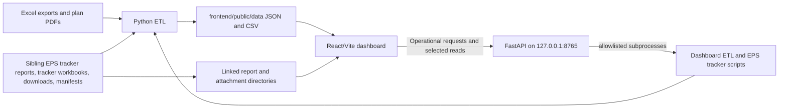

# Architecture

## Purpose

The IAD6 Infralink Dashboard combines engineering exports and locally managed
test/report artifacts into operational views centered on PDMs and equipment.
It covers readiness, issues, Infralink NETA evidence, third-party EPS execution,
monthly KPR metrics, data quality, floor/power-plan views, and MV equipment.

The repository contains two distinct runtime surfaces:

1. A React dashboard that primarily reads generated static JSON.
2. A local FastAPI control plane that runs a fixed set of Python automation
   jobs against this repository and a sibling EPS tracker repository.

Use [README](README.md) for setup, [Data Operations](docs/DATA_OPERATIONS.md)
and [Report operations](docs/REPORT_OPERATIONS.md) for operator procedures,
and [AGENTS.md](AGENTS.md) for implementation rules.

## System Flow

### Responsibility boundaries

| Layer | Owns |
| --- | --- |
| Python ETL | Input discovery and normalization, matching, data quality, aggregate datasets, and published evidence |
| React | Route data loading, interactive state, presentation, filters, and views derived from loaded records |
| FastAPI and runner | Request validation, authorization, run ownership and state, allowlisted commands, retries, and logs |
| EPS Tracker | Provider workflows, raw daily report parsing, report lifecycle, and CxAlloy upload decisions and history |

ETL publishes PDM → equipment → cases. Global Equipment also includes
unlinked SystemElements records. The dashboard reads evidence from the
Tracker and owns how that evidence is presented. A successful operator
write and publication of its dashboard snapshot are separate outcomes.
The automation runner owns recovery when publication fails after a write.

## Rule ownership

| Rule | Where to look first |
| --- | --- |
| Equipment matching and PDM assignment | [`match_equipment.py`](scripts/etl/match_equipment.py) and [`pdm_assignment.py`](scripts/etl/pdm_assignment.py) |
| EPS/NETA tracking | [`tracking_rules.py`](scripts/etl/tracking_rules.py) and [`equipmentTrackingUtils.ts`](frontend/src/utils/equipmentTrackingUtils.ts) for browser-side and legacy inputs |
| Open case status | [Python case rule](scripts/etl/case_status.py) and [frontend issue rule](frontend/src/utils/issueUtils.ts). [Shared test cases](scripts/tests/fixtures/case_status.json) check both runtimes. |
| NETA completion and report evidence | [`build_pdm_dataset.py`](scripts/etl/build_pdm_dataset.py) publishes both facts. [`pdmUtils.ts`](frontend/src/utils/pdmUtils.ts) and [`equipmentReadinessUtils.ts`](frontend/src/utils/equipmentReadinessUtils.ts) derive their respective views. |
| Cable test evidence and equipment energization readiness | [`cableTestUtils.ts`](frontend/src/utils/cableTestUtils.ts) and [`connectedCables.ts`](frontend/src/utils/connectedCables.ts). Equipment cable scope is specific to readiness. |
| KPR lifecycle | [`equipment_lifecycle.json`](config/equipment_lifecycle.json) and [`build_kpr_summary.py`](scripts/etl/build_kpr_summary.py) |
| CxAlloy status and pending equipment | [`build_cxalloy_report_status.py`](scripts/etl/build_cxalloy_report_status.py) publishes file evidence. [`equipmentUtils.ts`](frontend/src/utils/equipmentUtils.ts) applies the shared Overview/Equipment filter. |

Closed case statuses are `closed`, `complete`, `completed`, `cancelled`,
`canceled`, `void`, and `resolved`, after trimming and ignoring case. Cases
with missing or blank status count as open. Views with only aggregate data
keep their existing count fallbacks.

Equipment references containing `BATTERY`, `UPS6`, or `MBC`, and direct
`INV6` assets, are outside EPS/NETA tracking. `TX-INV6` remains tracked.
KPR lifecycle stages are mutually exclusive. Cumulative NETA completion
tracks a separate equipment total.

A NETA completion flag can coexist with a missing report finding. A verified
upload can coexist with an incomplete NETA flag. A cable scope with all known connections excluded can
satisfy cable readiness, while missing cable scope leaves it unconfirmed.

## Frontend Architecture

### Entry and routing

- `frontend/src/main.tsx` mounts `App` inside `BrowserRouter`.
- `frontend/src/App.tsx` owns route composition, common layout, loading/error
  boundaries, and return-to-Overview/KPR navigation state.
- All route pages load their code on demand inside a shared Suspense boundary.

Power Plan and Layout share `usePinchZoom`. See the
[frontend touch implementation notes](frontend/README.md#touch-map-controls)
for pointer handling.

### Data loading

`InfralinkEquipmentLinksProvider` loads the optional generated device-ID
manifest when a detail link first mounts, and invalidates it on dashboard ETL reload. The shared
detail-header link component builds JC2's main `DeviceFullPage;viewModelId=...`
route from a validated numeric ID. The main application handles sign-in and
hosts the embedded detail; linking directly to the embedded Angular application
can produce a blank Session-401 page in signed-out browsers. Automation storage
state is never transferred to browser links. Exact equipment references resolve links; missing and
ambiguous identities stay unavailable. This covers nested PDM details and
Layout cable inspectors as well as the equipment/map routes.

`CxalloyEquipmentLinksProvider` similarly loads an optional project-scoped link
dataset only when a detail link mounts and discards old-generation responses on
dashboard reload. Shared `EquipmentExternalLinks` pairs both vendor links at
all existing equipment/cable detail entries. Numeric project/equipment IDs build
fixed-origin CxAlloy detail URLs; missing and ambiguous mappings remain unavailable.
The CxAlloy builder reads a local inventory snapshot during ordinary ETL. Explicit
CLI refresh uses an operator-supplied browser state to read the full equipment
list, checks unique IDs, stable totals and pagination, and atomically replaces
the snapshot only after success. It reads no report-upload history and performs
no vendor writes. Exact names win over the Tracker's project-prefix/Utility
aliases; full cable IDs and other suffixes remain intact. Only identities and
diagnostics are published, never browser credentials.

`frontend/src/hooks/useDashboardData.ts` loads datasets by route, using the
explicit dependency map in `frontend/src/utils/dashboardResources.ts`:

- Overview includes equipment records so its pending CxAlloy metric covers
  standalone assets as well as PDM equipment. It shares Equipment's pending
  predicate: tracked, explicit NETA Complete, and at least one pending local
  PDF. File-level evidence takes precedence; legacy pending packages require
  positive available-file counts. Broad upload-manifest summary totals are not
  used for this dashboard metric; per-file upload evidence remains unchanged.
- PDMs waits only for PDM records and EPS PDM execution; its equipment section
  loads EPS module/test-item detail and report links when the drawer opens.
- Equipment starts its equipment/PDM/case, Layout connection, CxAlloy,
  report-manifest and history reads together. It uses all Layout cable records,
  including unplaced/unresolved connections, with exact endpoint matching and
  optional `IAD06-` prefix normalization. Its energization readiness requires
  explicit equipment NETA completion and every connected cable tested with an
  ATP/NETA report; absent cable scope stays unknown. Equipment excludes cables
  with either endpoint in the uploader's default excluded families from its
  list, test/report counts and readiness. UPP6 panels, TX-UPP6 transformers and
  CUPP6/TX-CUPP6 in the first R zone are in scope. Equipment also excludes all
  AHU6 endpoints and non-R-zone UPS6 endpoints. UPS6's first-zone R exception
  follows the same zone syntax. These
  page-specific additions do not alter uploader defaults or global tracking.
  If every known connection is excluded, cable requirements are
  satisfied; this differs from missing scope. Raw Layout data is unchanged.
  Shared Layout test rules
  and report evidence are reused without changing existing NETA quality metrics.
  EPS test items are no longer displayed or requested by Equipment.
  Power Plan starts only its PDM/equipment/case and EPS
  module/test-item reads. Status/filter dependencies finish before either renders.
- Layout reads its own manifest immediately, independently of dashboard data.
  Its NETA manifest and device identities are deferred until selection.
- Metadata loads without blocking pages. KPR drill-down query parameters request
  KPR context; Data Quality data is requested only for that route.
- `DashboardResourcesContext` lets detail/report/attachment consumers request
  shared datasets and distinguish loading from missing evidence. Loaded datasets
  are reused during navigation within one dashboard generation.
- Dashboard reload clears loaded and pending-request caches; late responses from
  the old generation cannot overwrite new data. Layout receives a reload version
  so its independent manifest refreshes too. No persistent data cache is introduced.
- Concurrent reads of one JSON URL share one pending fetch/parse; the low-level
  loader does not retain completed results across reloads.
- Dev and compiled preview intercept `/data/` JSON/CSV requests and stream live
  files from `frontend/public/data/` with `no-store`. Responses of at least 1 KB
  stream through gzip when accepted, with `Vary: Accept-Encoding` and identity/HEAD
  support; no compressed-file cache can outlive ETL output replacement. Preview retains built JS/CSS
  but reflects successful ETL outputs without a frontend rebuild. Missing live
  files return 404; path containment, real paths and extensions restrict serving.
- NETA PDF requests under `/neta-reports/` and `/neta-reports-gc/` also use live
  public directories/junctions in dev and preview. Missing reports return 404
  rather than SPA HTML; byte ranges support browser PDF viewers. Files remain
  constrained to each configured report root after realpath resolution.
  Issue attachments and reference drawings also use their live public roots.
  Compiled-preview startup omits public-file copying; ordinary static builds
  retain it.

The NETA manifest includes `_temporary/<equipment>/` from both report roots,
with `report_stage` (`temporary`/`formal`) and the actual equipment owner.
GC rename metadata maps files back to their original report names, including
absolute manifest paths and legacy flat outputs. For each owner/original-name/source,
ready formal files suppress temporary duplicates. The optional Tracker lifecycle
JSON gates original formal records on `download_ready` and GC records on
`formal_ready`, both in the formal stage; retained temporary files remain candidates
during failed promotion. Missing lifecycle entries preserve legacy behavior;
malformed state fails the build rather than publishing unverified formal files.
Internal underscore directories are excluded except the root `_temporary`.
The builder honors `IAD6_EPS_TRACKER_ROOT` and rejects conflicting public links.

Shared report tools accept equipment IDs, retain unambiguous legacy manifests
without ownership, and recognize exact asset-named shared cable PDFs under
endpoint directories. Temporary previews carry a visible label. Power Plan/MV
equipment details use the same report section; status and readiness inputs stay
unchanged. ETL/index rebuild plus dashboard refresh switches to the current
paths after Tracker cleanup; there is no real-time URL resolver.

The loader distinguishes initial and detail error states, but `fetchJson`
currently converts HTTP/network/parse failures to `null` plus a console warning;
missing files can therefore yield empty/null data rather than throwing. Several
specialist datasets are explicitly optional. `unwrapRecords` accepts both plain
arrays and record envelopes.

### UI organization

Layout's fixed equipment geometry and cable semantics remain separate from
display-only routing. `layoutCableRouting.ts` plans room aisle tracks and outdoor
upper-floor riser approaches, then performs bounded deterministic crossing
reduction with a spatial segment index. It preserves cable identities, roof ports,
floor membership and test evidence. `layoutSceneUtils.ts` caches single-floor
connections alongside the combined scene; SVG drawing, warning markers, culling
and camera fitting consume the same selected route geometry. No ETL contract or
published coordinates change when display routes change.

- `pages/` contains route-level screens.
- Domain components live under `components/{pdms,equipment,issues,overview}`.
- Shared visual primitives are under `components/common` and `components/ui`.
- Domain calculations, matching helpers, search, report linking, and Excel
  exports are under `utils/`.
- `types/data.ts` and `types/automation.ts` are the frontend contracts.
- Tests are colocated as `*.test.ts` and `*.test.tsx`, using Vitest, jsdom, and
  Testing Library.

The Equipment page flattens PDM equipment plus standalone equipment records so
that equipment missing from module links can still appear in global metrics and
lookup. URL query parameters carry drill-down filters from Overview and KPR.

The EPS execution route composes activity cards, breakdowns, and detail tables
from `components/eps/`. `useEpsExecutionRows` memoizes the pure selectors in
`utils/epsExecution*.ts`. The PDM and standalone test-item views share result
and tracker-type rules. Module details use equipment-scoped activity, while
the KPR test-item cohort matches exact item identifiers.

## ETL Architecture

### Inputs and discovery

`scripts/etl/file_discovery.py` selects the newest non-temporary workbook from:

- `raw_data/module/*.xlsx`
- `raw_data/system_elements/SystemElements_*.xlsx`
- `raw_data/cases/Cases_*.xlsx`

Power-plan builders also read PDFs from `raw_data/power_plan/`. Several EPS,
NETA, attachment, CxAlloy, and MV inputs are read from a sibling
`IAD6_EPS_Testing_Tracker` repository.

`build_layout_plan.py` separately reads the PDF/page/floor mappings in
`config/layout_plans.json`. Rectangle comments identify equipment; one boundary
rectangle clips each floor, and fix rectangles place contained devices in a
shared layer. Both controls are omitted from the SVG. Rotated PDF coordinates
are transformed and made relative to the boundary origin. Normalized equipment
IDs match only when unique; uncertain records remain visible with diagnostics.
`layout_plan.json` carries the floor geometry and SystemElements energized dates.
The `/layout` page loads this file on demand, keeps a common coordinate frame
across floors, and stores manual electrical-status overrides in browser storage.
Overrides are keyed by equipment ID and never modify workbook or server data.
POD and E-number room annotations are separate noninteractive regions, with
optional shared fixed regions. Equipment gets a bounded visual inset; source
geometry remains intact. Room labels have fixed positions in the background;
2.5D uses larger external callouts beyond the room back edges with leader lines,
included in the shared fit bounds. The 2D labels keep their inside positions.
Equipment is drawn above them, and all lightning markers are drawn together in
the final SVG layer. Energized has a stronger red fill/border. The SVG uses
a fixed-size canvas and a movable viewBox, pointer capture for panning, and a
non-passive wheel handler with cursor-anchored zoom. Global search suggestions
select the appropriate floor and focus the device. A single Energize today
toggle and reset controls replace the equipment-status selector.
Confirmed Excel energisation takes priority over stored planning overrides;
effective Energized status locks the planning button. A bounded HTML inspection
card shows the full ID/status on hover or keyboard focus at a fixed font size,
independent of SVG scale, without intercepting map pointer events.
Box select changes the pointer gesture from panning to a marquee in drawing
coordinates. It selects fully enclosed equipment IDs; Shift adds another group.
Bulk planning is idempotent and skips Energized IDs using the shared status rule.
Selection is cleared on floor changes/search confirmation/exit; overrides remain
in the existing browser-local storage, with existing global reset behavior.

Layout also offers a default 2.5D orthographic 2:1 SVG projection with illustrative device
heights and overhead cable routing, while keeping source footprints unchanged.
`layout_connections.py` adds optional `cables`, `cable_diagnostics`, and EPS/MV
daily report source metadata to the Layout manifest. Classification uses normalized equipment
Type; termination records are excluded. Complete FDR endpoint IDs are matched
against unique equipment IDs. Single-ended FD records additionally resolve from
the MV page's `Electrical-IAD6-MV.pdf` line/polyline endpoints using
`mv_layout_connections.py`: each port must be within 24 PDF points of exactly one
equipment rectangle on the same page. Termination labels never determine endpoints.
Conflicting diagram associations and missing equipment remain diagnostic records.
Mapped records retain `connection_source` and `mv_annotation_ids`; the source PDF
is included in Layout input metadata. Missing Layout placements retain both resolved
equipment keys without inventing positions. The frontend draws only unique endpoint placements visible in the chosen
scene; unresolved and duplicate-placement associations remain undrawn.
`layoutIsometricUtils.ts` owns projection, device kinds, connection placement, and
overhead paths. `layoutSceneUtils.ts` derives the default All floors 2.5D scene:
MV-type cables and MV-diagram mappings instead use illustrative underground
ducts with base entries, downward drops and square plan bends. Their separate
SVG layer sits below equipment; status colors, hit targets, markers and bounds
use the buried route. Other cable routes retain overhead geometry.
Second Floor translates vertically above First Floor with a compact lift based
on room depth and device height (currently 180 units), allowing empty extents to
overlap. Captions follow the room rows instead of enclosing the whole floor.
First Floor and deduplicated shared
outdoor placements stay in place. Display copies retain equipment/annotation
identity and floor membership without modifying manifest coordinates or contracts.
An aligned plan footprint across both floor inventories supplies the translucent
ground decks, faint grids and shallow edges. Shared outdoor assets are excluded
from the decks. Ground geometry is behind all equipment, is noninteractive and
is included in combined/single-floor isometric fit bounds; 2D remains unchanged.
Shared feeds to elevated floors retain native direct cubic arcs and render behind
equipment until selected/highlighted. Device cross-floor connections group by a
shared hub and destination floor, choosing the highest-degree endpoint with an
upper-floor/ID tie-break independent of feeder direction. Each group has a common
room-edge trunk spine, narrow parallel paths and independent terminal branches.
Destination positions determine stable lane ordering; individual cables remain
separate records and selected routes draw last above their siblings. Distant
left/right routing banks and default white crossing underlays are removed; local
overlap is allowed. Room lookup is floor-specific so overlapping display regions
cannot change same-floor routing. Original same-floor paths
translate with their floor; ground/shared paths remain unchanged. Every route's
points drive path, marker, fit bounds and culling. Search recognizes unique
cross-floor pairs, retains All floors when selecting equipment, and opens the
combined scene when selecting a cross-floor cable from a single 2.5D floor.
2D retains single-floor drawings; the previous 2.5D scope is restored on return.
Both views share the existing camera and planning state; switching
views resets the camera/selection geometry. Layout indexes exact FDR IDs from raw
EPS `Daily_test_report` files as well as MV daily results. `cableTestUtils.ts`
first treats a Feeder Cable ATP filename in System Elements as an attached
Infralink test report, then classifies the latest dated daily outcome when no
report is attached, using failure first on a same-day tie.
Cable test evidence and equipment
energisation remain independent; equipment tracking exclusions do not remove
physical cable connections. Global dashboard initial loading is unchanged.
Layout carries equipment NETA report names and cable `Feeder Cable ATP` names
from normalized System Elements. Its cable builder reuses Power Plan's ATP file
index, matching each listed filename within the exact cable ID folder. The
frontend previews those local PDFs; cable NETA PDFs are additionally resolved
by exact full FDR filename in the shared report manifest. A missing local PDF
remains an unclickable report reference, while its Infralink attachment field
still confirms that the report was entered there.
Linked ATP/NETA names are shown once; equipment PDF previews prefer GC-renamed
links. In 2.5D, selection only changes emphasis and detail state; explicit
Zoom actions own camera changes.
Equipment illustrations use closed, independently shaded top/left/right faces
and separate structures for six device types. UPS6 uses modular UPS cabinets
with dark segmented doors, a display and vents at full/simple/compact detail.
Nearby connections use low
cubic arcs; longer paths have rounded bends. Cable path bounds are included in
the shared fit frame and connection zoom. Room-to-upper-outdoor feeders instead
use vertical risers/drops and grid-aligned trays along the room's back boundary
and above the target equipment column, keeping long runs away from the open
center. Approach coordinates stay within the endpoint span to avoid backtracking.
Small rounded elbows and separate boundary/column lanes remain. Their warnings
follow the longest straight tray segment and bounds include every turn. Other routes retain
their existing geometry. Global view/Escape clear focus and
search and restore the full camera without changing energisation overrides;
blank map clicks clear focus while retaining the current camera.
Layout performance separates static model geometry from selection overlays and
uses memoized equipment/cable/background components with stable event callbacks.
Current-floor 2.5D SVG models remain mounted, hidden, after switching to 2D;
floor changes still replace floor-local geometry. Cable paths, lookup indexes,
diagnostic counts and both view fit frames are memoized. `useFrameState.ts`
coalesces wheel/pan updates using requestAnimationFrame, flushes final drag
positions and cancels queued camera movement on explicit commands or unmount.
2.5D wheel zoom does not use that path. The measured bottleneck is GPU raster of
the whole SVG (hundreds of ms per raster on integrated GPUs), not React. During a
2.5D wheel gesture `LayoutPlanPage` previews zoom as a rAF-eased inline CSS
transform on the pan layer (`layoutViewportTransform`, `interpolateLayoutTransform`
and `rebaseLayoutTransform` in `layoutPlanUtils.ts`). It commits the accumulated
viewBox once, 160 ms after the last wheel event, so culling/LOD refresh only
then. Constraints that keep the preview raster-free: the 2.5D pan layer stays
permanently `will-change: transform` (promoting/demoting it re-rasters); easing
uses rAF plus inline styles, never `element.animate()` (Chrome re-rasters at the
animation's target scale); no mid-gesture viewBox rebase; hover inspection is
suppressed while a wheel zoom is active; lightning marks render in a separate
overlay `<svg data-layout-overlay="lightning">` with its own layer, and
`[data-layout-gesture]` pauses their breathing animation, because any animated
child inside the scene SVG repaints the whole SVG. Pointer down settles a pending
wheel zoom first. Plan-view wheel zoom keeps the `useFrameState` viewBox path.
Hide all cables removes cable marks/hit targets without changing connection data;
Global view, search and floor/view changes preserve the user's visibility choice.

### Pipeline

`build_infralink_equipment_links.py` joins normalized equipment names to a local
project-scoped JC2 identity snapshot. Its optional CLI `--refresh --auth-state`
reads the same project contract scope used by the sibling NETA downloader and
queries JC2's paginated device grid using the saved session. Only names and
numeric IDs are retained. Complete snapshots replace the local cache atomically;
authentication errors, pagination inconsistencies and invalid identities fail
before replacement. Normal ETL stays offline and reports missing/ambiguous
links in the generated manifest. Existing published identities can be reused
when a deployment does not have the local cache.

`scripts/etl/run_etl.py` is the orchestrator. It runs, in order:

1. Workbook inspection and normalization of equipment, modules, and cases.
2. Equipment matching for module links and cases.
3. PDM dataset and summary construction.
4. Seven-day/history, EPS execution, and monthly KPR datasets.
   EPS execution additionally publishes `eps_daily_report_audit.json`, combining
   raw EPS/MV Tested/Passed, Failed and Retested And Passed evidence (ignoring
   Partially Tested). Complete normalized IDs identify repeat candidates; source
   lines and conflicting/same-day records remain intact. This route-specific
   evidence does not change tracker completion or KPR totals.
5. NETA report manifest and reviews, then the NETA test-position check, then the
   data-quality report (it reads `neta_position_check.json`), then CxAlloy,
   issue-attachment, power-plan/MV, Layout, and equipment-link manifests.
6. ETL metadata and record-count reporting.

Builders publish under the gitignored `frontend/public/data/`. The ETL stops
on the first failed step and writes run metadata after success. Earlier steps
may already have published new outputs when a later step fails. The shared
`json_utils.write_json` replaces one complete file at a time. Quality findings
are published in the data-quality report.

Full runs scope a content-addressed normalization cache to the pipeline.
`workbook_cache.py` verifies source workbook bytes and versions all ETL Python
sources plus Python/openpyxl before reusing equipment/case records. Persistent
entries live only in gitignored `runtime/etl-cache/workbooks/`; missing, corrupt
or unwritable cache files do not change parsing/error behavior. In-memory reuse
returns isolated records. Standalone normalizers remain uncached. EPS equipment
lookups pre-index suffix matches, preserving exact-match priority and the shortest
fallback, while all historical snapshots continue to rebuild on each run.
Each step reports elapsed seconds in existing ETL logs.

### Matching and assignment

- Equipment matching proceeds through exact, project-prefixed/normalized,
  whitespace/case-normalized, and terminal-suffix matching.
- A trailing `0x-R` and `0xR` suffix are treated as equivalent.
- Unique matches are `matched`; multiple matches are `ambiguous`; unmatched
  records are retained.
- PDM assignment may use a SystemElements parent only when it is a PDM and does
  not conflict with the module-list area scope.

### Main data models

There is no database. `scripts/etl/schemas.py` defines the normalized dataclass
contracts:

- `Equipment`
- `ModuleEquipmentLink`
- `CaseIssue`
- `PdmRecord`
- `PdmEquipmentRecord`
- `NetaValidationRecord`
- `DataQualityReport`

The primary hierarchy is PDM -> equipment -> cases. Additional generated models
cover EPS test items and module/PDM execution, KPR lifecycle/trends, report and
attachment manifests, power-plan annotations, MV daily test status, and
CxAlloy upload status.

### Contract changes

- Use `scripts/etl/json_utils.py` and `frontend/src/utils/dataLoaders.ts` for
  supported record JSON formats, including bare arrays and `{ records }`
  envelopes with source metadata. Manifest objects have dataset-specific shapes.
- Keep schemas and builders, `frontend/src/types/data.ts`, resource loaders,
  and affected views in sync. When introducing a dataset, register its ETL
  output and declare only the route or drawer dependencies that consume it.
- Preserve equipment identity, evidence and diagnostic records across the
  producer/consumer boundary. Define the meanings of missing, empty and false
  when the contract uses them. Keep metadata and row ordering stable where
  callers rely on them. Exercise the normal producer and consumer in addition
  to unit coverage of the changed decision.

## NETA duplicate evidence and decisions

The automation API serves staged completed-report PDFs by opaque conflict ID,
revision, and side. The Tracker validates staged hashes, stores the version
decision, and publishes an eligible formal batch on completed-report refresh.
ETL projects active formal filenames, including Updates-only reports, and their
PDF fingerprints. The next normal CxAlloy upload uses that batch. See
[completed report version operations](docs/REPORT_OPERATIONS.md#completed-neta-report-versions).

The report manifest builder reads the configured Tracker's v2 duplicate audit
through its `neta_duplicate_decisions` validation API. Candidate GC paths must
remain within the report root, belong to active rename rows and the current
stage/batch, retain the recognized-name/category scope, and match both SHA-256
values. Only candidate files are hashed. Original and GC links resolve through
the existing public report index; missing public copies invalidate actions.
The manifest adds `duplicate_audit` with explicit availability, diagnostics and
typed group records. No equipment readiness or completion contract changes.

The protected duplicate-decision POST accepts a match ID, expected revision,
confirm/revoke action and explicit confirmation. `update_neta_duplicate_decision`
is an internal allowlisted runner job with server-derived actor identity; no
client paths or commands are accepted. Validation runs before scheduling and
again in the worker. Tracker owns atomic decision history and audit writes,
report-directory locking and the existing CxAlloy project lock. Manual revocation
retains history and cannot revoke automatic byte/render evidence. Upload aliases
also read current decisions, so an interrupted audit rewrite cannot revive a
revoked confirmation. No network upload is performed by these tasks.

After saving, the worker rebuilds the report manifest. A separate allowlisted
`refresh_neta_duplicate_evidence` job retries publication without changing a
decision or rescanning PDFs. React reloads this resource in place; loaded routes,
filters and drawers remain mounted. Static readers use the published snapshot;
mutations require the existing operator API and both updated checkouts.

GC report names are renamed from the Equipment drawer only by the loopback
`local_operator` (Clerk sessions are read only). The drawer previews through
`POST /neta-report-names/preview`, then `POST /neta-report-names` schedules the
hidden `rename_neta_gc_report` job with the GC relative path, new name and the
manifest `source_sha256`. Both the endpoint and `TaskManager.start_job` reject
other identities. The worker calls Tracker `neta_report_rename.py`, which renames
the PDF, manifest and lifecycle together and queues a CxAlloy replacement when
the equipment was already uploaded; the next CxAlloy upload deletes the old
attachment and uploads the renamed PDF. The worker then republishes the report
manifest (with `pending_cxalloy_rename`) and the static review snapshot.

## NETA test-position baselines

Equipment of one family should carry the same set of NETA reports. The Tracker's
`neta_report_fields.py` (NETA post-processing, after result checking) reads the
header of every GC device report by word coordinates (PyMuPDF), OCRs only the
header band of pages without a text layer, and writes
`NETA_eport_To_GC/report_fields.json` keyed by SHA-256 (reused while the bytes and
parser version are unchanged). The dashboard never opens PDFs for this.

`scripts/etl/neta_positions.py` reduces the PDF ASSET / CT FILENAME /
DESIGNATION (falling back to the GC name) to a canonical position key, votes the
owning equipment from ASSET/SUBSTATION/EQUIPMENT ID/STATION, groups equipment
into families (`MDS6|A-F`, `PDU6|A-F|sub`, `RP6|H1`), drafts a baseline from
positions present in more than half of the NETA-complete members, and compares
each equipment per position. Same-day FAIL beats PASS; otherwise the newest
result wins; FAIL+PASS without dates needs review. Two PASS reports with
different SN are flagged. `build_neta_position_check.py` writes
`neta_position_check.json`; cable (`FDR`/`ATR`/`CB`) reports are excluded.
A Tracker form classified as `oil_analysis` maps to the separate
`OIL-SAMPLE` position. For TX6, the transformer test occupies `EQUIPMENT`,
even when both PDF headers carry the same equipment designation. Tracker uses
these forms to name verified oil samples and recover ambiguous CT phase names.

Confirmed baselines live in `config/neta_position_baselines.json` (committed).
`GET/PUT/DELETE /api/automation/neta-position-baselines[/{family}]` validate keys
and aliases, require the loaded `revision` (409 on a stale save), write
atomically, and allow edits only by the loopback `local_operator`. Families
without a confirmed baseline are compared with the draft and labelled as such;
only confirmed families feed `neta_complete_but_nonconforming` in the
data-quality report. The `/neta-baselines` page edits baselines; Equipment adds
a Report baseline filter (`?baselineIssue=`), a drawer Test positions section,
and PDF-derived GC name suggestions that only pre-fill the existing rename flow.
When the OCR header and GC name show the same position typo, the Tracker can
use the dashboard's confirmed positions and aliases to suggest a unique
correction. It projects suggestions by GC path from the cached fields. The ETL
reuses the same rules with the current configuration, so a baseline edit takes
effect on the next ETL without rerunning OCR. Suggestions preserve existing
filename annotations and require the operator to confirm the rename.

On `/neta-baselines`, the local operator can link a report to a confirmed
position for one equipment. The revision-checked position-links API saves
these mappings in the family baseline by equipment ID and report SHA-256.
ETL applies an unambiguous link before comparing positions, keeps the parsed
position for inspection, and suppresses the linked report's rename suggestion.
Result and retest handling use the existing report statuses. Missing,
ambiguous, or invalid links appear in the position check for review.

## Automation Backend

`scripts/automation/api.py` exposes a FastAPI API. `scripts/automation/runner.py`
implements an allowlisted, single-active-run task manager with persisted run
records/logs under `runtime/automation/` (latest 50 exposed by the API).

API groups:

- Health, job definitions, runs, incremental logs, cancellation, and resume.
- Daily pipeline execution.
- JC2 and CxAlloy interactive login continuation.
- EPS and MV daily-report list/read/validate/save operations.

The daily pipeline runs preflight, JC2 workbook refresh, daily report wash,
NETA/Feeder ATP/issue downloads, GC organization, and dashboard ETL. It stops at
the first failure and can resume from a failed/auth-required/interrupted step.
A successful manual daily pipeline turns on in-memory auto-sync. `TaskManager`
then starts an `auto_sync` run 10 minutes after the previous run finishes
(`IAD6_AUTO_SYNC_INTERVAL_S`). Each run is a light sync (preflight, JC2 export,
wash, ETL), except at most once per hour (`IAD6_AUTO_FULL_INTERVAL_S`), when the
full pipeline runs instead. If another task is active, the due run waits. Any
auto run that fails, needs auth, or is cancelled turns auto-sync off until the
next successful manual refresh. A service restart also turns it off. A new
auto-sync export deletes the previous auto-sync export from the same day; manual
exports and exports from earlier days are kept. Auto runs keep their own
20-run history. `/api/automation/health` reports the state as `auto_sync`.
Operators can edit the light and full intervals (whole minutes, 1-1440, full >=
light) on the Auto-sync panel. Edits go to `PUT /api/automation/auto-sync/settings`,
are saved to `runtime/automation/auto_sync_settings.json`, override the environment
defaults, and reschedule a waiting sync from the previous run's finish time.
Auto-sync is one global schedule, not one per operator. Each auto run uses the JC2
session of the operator whose manual refresh most recently succeeded; a successful
manual refresh by another operator takes it over. Other operators see its state as
`owned_by_other`, without the owner's ID, run ID or stop reason, and cannot change
its intervals (403).
Onsite/Offsite daily-report endpoints accept a fixed site enum and ISO date
filenames. Their three-section editor preserves duplicate evidence. Saves are
atomic and schedule the allowlisted wash job; saved evidence remains recoverable
if scheduling fails. Legacy endpoints remain for corrections. The shared parser
and daily result projection live in the sibling Tracker's `daily_report_sources.py`;
Dashboard adapters load that module using the configured tracker root. Both projects
must be deployed together. It reads all four raw source directories, keeps exact
normalized IDs and source line numbers, ignores Partial, and projects daily status
separately from the raw audit. The EPS compatibility summary excludes legacy MV;
MV and Layout projections retain their historical source scopes plus new site
records. Cross-report same-day site conflicts use failure first. Rebuilding does
not normalize or rewrite raw files. The standalone Tracker Excel entry point
refreshes its summary through the same module before using it.

Commands are assembled from `JOB_DEFINITIONS`; clients cannot submit script
paths or arbitrary commands. Options are validated per job. Live CxAlloy upload
is marked dangerous and requires confirmation.

Treat a stored decision and its published dashboard snapshot as two outcomes.
For example, the duplicate-evidence refresh job can retry publishing after a
decision was saved. Authorization, locking and revision checks belong at the
existing write boundary. The calculation can report the proposed result before
that boundary applies it.

## Authentication and Authorization

- Dashboard pages can be viewed without signing in. Data Operations uses Clerk
  and server-side authorization, or the opt-in local operator mode.
  `CLERK_ALLOWED_USER_IDS` controls remote API access independently of Clerk
  account invitations.
- The backend validates Clerk RS256 session signatures using the configured
  issuer's JWKS, time claims, session status, and exact authorized frontend
  origins. Missing Clerk configuration denies remote operations. An opt-in local
  bypass permits only direct loopback requests with local host/origin and no
  proxy/forwarding headers; Vite marks every proxy request to prevent bypass.
  The GETs for `/api/automation/mv-equipment-comments` and
  `/api/automation/neta-report-reviews` allow anonymous dashboard reads. All
  operational reads and writes require an authorized operator. Layout manual
  energization, GC report renaming and NETA baseline mutations have additional
  local-operator restrictions.
- Personal provider logins use owner-bound remote browser windows rendered as
  transient screenshots with restricted click/text/key/scroll actions. An
  isolated Playwright context supports Microsoft phone MFA and CxAlloy login.
  Save is allowed only back on the provider origin after login fields disappear
  and browser state exists. Screenshots/input are not persisted; sensitive
  storage state lives outside the repo under a hash of the verified Clerk ID.
- Provider jobs receive explicit personal `--auth-state` paths and never fall
  back to the shared VM state. Run records carry owner IDs; API history, logs,
  resume and cancellation are owner-scoped. The host retains a single job lock
  because project outputs remain shared. Legacy desktop-login HTTP endpoints
  return 410; direct local CLI behavior remains available for maintenance.
- The automation service is started on `127.0.0.1:8765`; CORS permits only
  localhost/loopback origins.
- JC2 and CxAlloy authentication is delegated to Playwright-driven sibling
  scripts. Browser state is stored outside the repository under local app data.
- Vite proxies `/api/automation` to the loopback backend, allowing an HTTPS ngrok
  tunnel to frontend port 5173 to serve authenticated operations. Clerk login
  does not replace the host's JC2/CxAlloy browser sessions.
- Vite's Feeder Cable ATP middleware only serves `.pdf` files resolved inside
  the configured ATP directory.

## External Integrations

- JC2: SystemElements/Cases exports, NETA reports, Feeder Cable ATP PDFs, issue
  and corrective attachments.
- Sibling EPS tracker: tracker Excel data, EPS and MV daily Markdown reports,
  report downloads, GC rename/upload manifests, and automation scripts.
- CxAlloy uploads run the sibling Tracker's `upload_cxalloy_reports.py` with
  the operator's auth state and supported options, including Force. Tracker
  owns upload selection, lifecycle, replacement and verification. The Dashboard
  derives read-only status from local evidence. The automation runner enforces
  serialization and explicit live-upload confirmation.
- Local filesystem links/junctions expose downloaded NETA and issue files under
  `frontend/public/` for browser viewing.

Keep credentials and instance-specific endpoint overrides in local configuration.

## Configuration and Deployment

Use [README](README.md#quick-start) for local launch and Tracker location,
[Data Operations](docs/DATA_OPERATIONS.md#choose-operator-access) for Clerk
and local operator configuration, and
[personal provider sessions](docs/DATA_OPERATIONS.md#personal-jc2-and-cxalloy-sessions)
for login configuration. The sibling Tracker owns the configurable JC2
SystemElements view URL.

Static deployments serve dashboard pages and published files. Data Operations
requires the loopback service, Tracker checkout, and host filesystem.
The dashboard uses generated files and has no database service.

## Evidence and Metric Invariants

- EPS uses test-item/component units. Label units explicitly when showing EPS
  alongside equipment-level NETA totals.
- Preserve issue and corrective evidence. Missing values drive quality findings.
- Generated report and attachment manifests carry metadata and browser paths.
  The files are served from their configured public roots.

## Directory Map

| Path | Responsibility |
| --- | --- |
| `frontend/src/App.tsx` | Routes, loading boundaries, return navigation |
| `frontend/src/hooks/useDashboardData.ts` | Initial and deferred JSON loading |
| `frontend/src/pages/` | Dashboard route implementations |
| `frontend/src/types/` | Frontend data and automation contracts |
| `frontend/src/utils/` | Domain logic, search, links, and exports |
| `scripts/etl/run_etl.py` | Full ETL orchestration and metadata |
| `scripts/etl/schemas.py` | Normalized Python data contracts |
| `scripts/etl/tracking_rules.py` | Shared EPS/NETA inclusion rules |
| `scripts/etl/build_eps_test_execution.py` | Third-party test execution datasets |
| `scripts/etl/build_kpr_summary.py` | Monthly KPR and lifecycle movement |
| `scripts/etl/build_power_plan.py` | PDF annotations, MV tests, ATP evidence |
| `scripts/automation/api.py` | Local HTTP API |
| `scripts/automation/runner.py` | Allowlisted task and pipeline execution |
| `scripts/automation/daily_reports.py` | Safe EPS/MV Markdown handling |
| `config/equipment_lifecycle.json` | Ordered lifecycle definition |

## Known Gaps

- **Input mutation:** `neta_positions.compare_equipment` annotates supplied
  report objects with GC-name fallback positions. Keep that evidence explicit
  when refactoring this comparison and check the published position diagnostics.
- **Unknown:** The production hosting, reverse proxy, TLS, and CI/CD design is
  not present in this repository.
- **Unknown:** Canonical Python and Node.js versions are not pinned by project
  metadata.
- **Needs verification:** `vite.config.js`/`vite.config.ts` and
  `tailwind.config.js`/`tailwind.config.ts` coexist and are not equivalent; the
  intended source-of-truth configuration should be confirmed before cleanup.
- **Needs verification:** Some ETL manifest builders use a fixed sibling tracker
  path while other components honor `IAD6_EPS_TRACKER_ROOT`.
- **Needs verification:** Decide whether missing required dashboard JSON should
  fail loudly; the shared fetch helper currently returns `null` after logging.
- **Needs configuration:** Clerk invite-only access, authorized operator IDs,
  and exact frontend origins before using Data Operations. A permanent
  deployment design remains separate from the local ngrok trial.
- **TODO:** Define a lint tool and command if lint enforcement is required.
